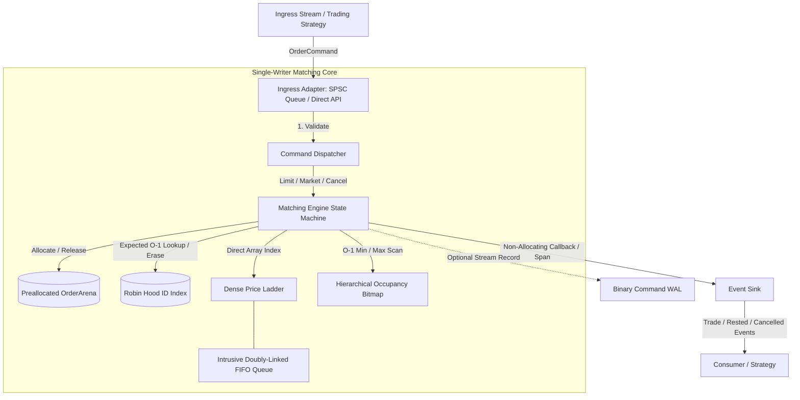

# NexusMatch (QD-01)
## Ultra-Low-Latency Limit Order Book & Matching Engine in Modern C++20

[](https://github.com/AnushKamble/NexusMatch)
[](https://en.cppreference.com/w/cpp/20)
[]()
[](LICENSE)

An in-memory, deterministic limit order book and matching engine written in modern C++20 implementing price-time priority (FIFO), expected $O(1)$ lookup with worst-case $O(1)$ order cancellations via intrusive doubly-linked lists, a pre-sized Robin Hood order-ID index, dense price-level arrays with a hierarchical occupancy bitmap, and **zero dynamic heap allocations on the critical trading path**.

---

## 1. Key Performance Highlights

Benchmarked on **AMD Ryzen 9 8940HX (Zen 4, 16 Cores, 32 Threads, 32MB L3 Cache)** on Linux x86_64:

- **Throughput:**
  - **Balanced Mixed Workload (60% Limit, 30% Cancel, 10% Market):** **3,548,365 ops/sec**
  - **Cancel-Heavy Workload (50% Limit, 50% Cancel):** **4,776,329 ops/sec**
  - **Trade-Heavy Workload (100% Crosses):** **3,367,179 ops/sec**
- **Core Execution Service Latency:**
  - **Median (p50):** **140 ns – 190 ns**
  - **95th Percentile (p95):** **300 ns – 360 ns**
  - **99th Percentile (p99):** **450 ns – 480 ns**
  - **99.9th Percentile (p99.9):** **641 ns – 730 ns**
- **Hot-Path Allocations:** **Strictly 0 dynamic heap allocations** (`operator new`/`malloc`) across 1,000,000 order streams within configured capacity (verified via scoped allocation interception). In comparison, a standard `std::map<uint32_t, std::deque<Order>>` baseline incurred **257,717 heap allocations** over just 200,000 orders.

---

## 2. System Architecture



### Architectural Highlights
1. **Compact 32-Byte Order Nodes:** `OrderNode` is packed into exactly 32 bytes (`alignas(8)`). This enables **two complete orders to reside in a single 64-byte L1 CPU cache line**, doubling L1 cache capacity over naive 64-byte padded proposals.
2. **Robin Hood Order-ID Index:** Employs open addressing with **backward-shift deletion** on a power-of-two table (load factor $\le 0.70$). Tombstones never accumulate, ensuring predictable bounded lookups without runtime rehashes or allocations.
3. **Hierarchical Occupancy Bitmap:** Organizes price occupancy into 64-bit word hierarchy levels. Finding the best bid or ask executes via single-cycle bit manipulation intrinsics (`std::countr_zero` / `std::countl_zero` compiling to `tzcnt` / `lzcnt`).
4. **Deterministic Binary Command WAL:** Checksummed with **CRC32C (Castagnoli)**. Replaying an identical WAL into a fresh engine instance yields bit-for-bit identical trade sequence numbers, snapshots, volume accounting, and 64-bit state hashes.
5. **Lock-Free Atomic SPSC Queue:** Single-Producer Single-Consumer ring buffer with cache-line-separated indices and acquire-release memory ordering, verified clean under ThreadSanitizer.

---

## 3. Quickstart & Build Instructions

### Prerequisites
- Modern C++ compiler supporting **C++20** (GCC 11+, Clang 14+)
- **CMake 3.20+**
- Linux x86_64 (Native or WSL2)

### 3.1 Build Release Target
```bash
# Configure and build optimized binaries
cmake -B build -DCMAKE_BUILD_TYPE=Release
cmake --build build -j
```

### 3.2 Run Test Suite
```bash
ctest --test-dir build --output-on-failure
```
All 10 test suites (smoke, semantics, arena, id_index, intrusive_queue, price_bitmap, matching, invariants, differential, spsc, wal) run in parallel with 100% pass rate.

### 3.3 Run Sanitizer Builds
```bash
# AddressSanitizer (ASan) + UndefinedBehaviorSanitizer (UBSan)
cmake -B build_asan -DCMAKE_BUILD_TYPE=Debug -DENABLE_ASAN_UBSAN=ON
cmake --build build_asan -j
ctest --test-dir build_asan --output-on-failure

# ThreadSanitizer (TSan) for SPSC Ingress Queue
cmake -B build_tsan -DCMAKE_BUILD_TYPE=Debug -DENABLE_TSAN=ON
cmake --build build_tsan -j
./build_tsan/test_spsc
```

### 3.4 Run Live Demo (60-90 Second Walkthrough)
```bash
# 1. Run live demonstration executing 500,000 orders and writing WAL
./build/nexusmatch_demo --scenario mixed --orders 500000 --wal demo.wal

# 2. Replay from WAL and verify bit-for-bit deterministic state hash
./build/nexusmatch_demo --replay demo.wal
```

### 3.5 Run Benchmark Suite
```bash
./build/nexusmatch_bench --orders 1000000 --json benchmark_results.json --csv benchmark_results.csv
```

### 3.6 Launch Interactive Web Trading Terminal
NexusMatch includes an institutional-grade, real-time web trading terminal connected directly to the C++ matching engine via WebSocket:
```bash
# Start the web bridge and terminal
python run_web.py
```
Open your browser at **`http://localhost:8088`** to access:
- **Interactive Level 2 Depth Ladder (DOM):** Live orderbook with proportional visual volume bars, spread meter, and 1-click price entry.
- **Order Execution Terminal:** Interactive order entry for Limit, Market, and Cancel commands with instant nanosecond latency readout.
- **Self-Trade Prevention (STP) Interactive Test:** 1-click button to visibly demonstrate **Cancel Aggressor Remainder** STP policy in real time.
- **Cumulative Depth Chart:** 60 FPS HTML5 Canvas plotting real-time bid and ask supply/demand curves.
- **Live Trade Tape & Event Blotter:** Streaming match executions, order resting, cancellations, and invariant audit logs.
- **Background Market Maker Simulation:** Toggle synthetic liquidity generator to watch the book dance in real time.

---

## 4. Benchmark Performance Matrix

| Scenario | Orders | Throughput (ops/s) | p50 (ns) | p90 (ns) | p95 (ns) | p99 (ns) | p99.9 (ns) | Hot-Path Allocs |
|---|---:|---:|---:|---:|---:|---:|---:|---:|
| **Balanced-Mixed** | 1,000,000 | **3,548,365** | 190.0 | 290.0 | 360.0 | 480.0 | 730.0 | **0** |
| Baseline (Map/Deque) | 200,000 | 4,297,036 | 160.0 | 330.0 | 400.0 | 561.0 | 931.0 | 257,717 |
| **Cancel-Heavy** | 1,000,000 | **4,776,329** | 140.0 | 230.0 | 300.0 | 450.0 | 641.0 | **0** |
| **Trade-Heavy** | 1,000,000 | **3,367,179** | 210.0 | 330.0 | 400.0 | 491.0 | 751.0 | **0** |

*Measured on AMD Ryzen 9 8940HX, GCC 11.4.0, Release build. See `docs/PERFORMANCE_REPORT.md` for full breakdown.*

---

## 5. Repository Structure

```text
nexusmatch/
├── CMakeLists.txt              # Production CMake build configuration
├── README.md                   # Project documentation and quickstart
├── include/nexusmatch/         # Public headers
│   ├── types.hpp               # Typed OrderCommand, Bbo, VolumeAccounting, Stats
│   ├── config.hpp              # EngineConfig validation
│   ├── event.hpp               # 48-byte compact EngineEvent tagged union
│   ├── event_sink.hpp          # Non-allocating Count, Span, and Vector event sinks
│   ├── order_node.hpp          # 32-byte cache-aligned OrderNode struct
│   ├── order_arena.hpp         # Contiguous object pool & free list allocator
│   ├── order_id_index.hpp      # Power-of-two Robin Hood hash table
│   ├── intrusive_queue.hpp     # Index-linked intrusive doubly-linked queue
│   ├── price_ladder.hpp        # Bounded dense tick-indexed price ladder
│   ├── price_bitmap.hpp        # Hierarchical multi-level occupancy bitmap
│   ├── order_book.hpp          # LimitOrderBook state & BBO discovery
│   ├── matching_engine.hpp     # Hot-path price-time FIFO matching engine
│   ├── state_hash.hpp          # Deterministic canonical FNV-1a state hasher
│   ├── spsc_queue.hpp          # Cache-line-separated atomic SPSC queue
│   └── command_wal.hpp         # Binary WAL writer, reader & CRC32C engine
├── src/                        # Implementation files
│   ├── order_arena.cpp
│   ├── order_id_index.cpp
│   ├── price_bitmap.cpp
│   ├── order_book.cpp
│   ├── matching_engine.cpp
│   ├── spsc_queue.cpp
│   ├── command_wal.cpp
│   └── main.cpp                # CLI demo application
├── tests/                      # Automated test suite
│   ├── test_smoke.cpp
│   ├── test_semantics.cpp      # FIFO, maker-price, STP semantic unit tests
│   ├── test_arena.cpp          # Arena exhaustion, churn, reuse
│   ├── test_order_id_index.cpp # Robin Hood collisions, backward-shift delete
│   ├── test_intrusive_queue.cpp# Link reciprocation & head/tail unlinking
│   ├── test_price_bitmap.cpp   # Multi-level word boundaries & scan oracle
│   ├── test_matching.cpp       # Core matching integration tests
│   ├── test_invariants.cpp     # 18-invariant property checker & fuzzing
│   ├── test_differential.cpp   # 30,000 order differential fuzzing vs reference
│   ├── test_spsc.cpp           # 2-thread monotonic sequence stress test
│   ├── test_wal.cpp            # WAL corruption, truncation & replay equivalence
│   ├── reference_engine.hpp    # Standard-container reference model
│   └── test_utils.hpp          # SplitMix64 deterministic PRNG & assertions
├── benchmarks/                 # Performance evaluation harness
│   ├── bench_main.cpp          # Google Benchmark / standalone multi-scenario suite
│   ├── benchmark_timer.hpp     # Steady clock & serializing RDTSCP timer
│   ├── workload_generator.hpp  # Pre-generated synthetic workloads
│   └── allocation_counter.hpp  # Global operator new/delete allocation tracker
└── docs/                       # Technical whitepapers & architecture records
    ├── ARCHITECTURE.md
    ├── MATCHING_SEMANTICS.md
    ├── MEMORY_LAYOUT.md
    ├── BENCHMARK_METHODOLOGY.md
    ├── PERFORMANCE_REPORT.md
    ├── WAL_FORMAT.md
    └── adr/
        ├── 0001-single-writer-engine.md
        ├── 0002-fixed-capacity-storage.md
        └── 0003-integer-tick-prices.md
```

---

## 6. ATS Keywords & Interview Positioning

- **Keywords:** Modern C++20, Low-Latency C++, Limit Order Book, Core Matching Engine, Price-Time Priority (FIFO), Intrusive Doubly-Linked List, Object Arena, Memory Pool, Robin Hood Hashing, Backward-Shift Deletion, Hierarchical Bitmap, Lock-Free SPSC Queue, Write-Ahead Log (WAL), Deterministic Replay, Zero Heap Allocation, RDTSCP, AddressSanitizer, ThreadSanitizer.
- **Resume Impact Statement:**
  > "Engineered an ultra-low-latency in-memory limit order book and matching engine in modern C++20 implementing price-time priority, intrusive doubly-linked queues, and pre-allocated object arenas. Achieved 3.55M+ ops/sec throughput, 190ns median service latency, and zero dynamic heap allocations on the hot path under continuous 1,000,000 order streams, validated with ThreadSanitizer and differential testing."
