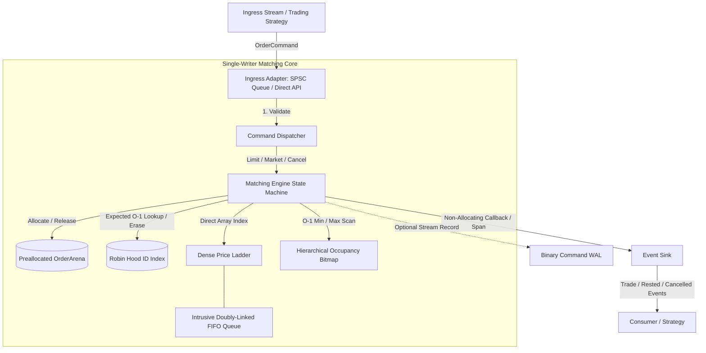

# NexusMatch Architecture Specification

NexusMatch is a deterministic, in-memory limit order book and matching engine engineered in modern C++20 for sub-microsecond tick-to-trade execution with zero dynamic heap allocations on the critical trading path.

---

## 1. System Topology & Data Flow

---

## 2. Core Architectural Principles

### 2.1 Single-Writer Core
- The matching state machine (`LimitOrderBook`, `OrderArena`, `OrderIdIndex`, `PriceLadder`, `PriceBitmap`) is strictly single-threaded.
- **Zero Mutex Contention:** By confining state mutation to one dedicated core, no thread locks, atomic compare-and-swap (CAS) loops, or cache line bouncing occur during matching.

### 2.2 Preallocated Fixed-Capacity Storage
- Backing buffers for order nodes, hash index slots, price levels, and occupancy words are sized once during startup.
- Once matching commences, no calls to `malloc`, `free`, `new`, or `delete` occur within configured capacity.

### 2.3 Mechanical Sympathy & Cache Locality
- Internal references between orders and queues use 32-bit arena array indices rather than 64-bit pointers.
- Order nodes are packed into exactly 32 bytes (`alignas(8)`), enabling two complete orders to fit within a single 64-byte L1 CPU cache line.
- Cancellations perform an expected $O(1)$ hash lookup followed by strict $O(1)$ doubly-linked unlinking via embedded `prev_index` and `next_index` fields.

### 2.4 Hierarchical Occupancy Indexing
- Price levels use dense direct-index arrays for instant $O(1)$ tick lookup.
- Best Bid (maximum occupied bid tick) and Best Ask (minimum occupied ask tick) are discovered using multi-level bitwise words. C++20 `<bit>` intrinsics (`std::countr_zero` / `std::countl_zero`) map directly to single-cycle CPU instructions (`tzcnt` / `lzcnt`).
